# 🔐 Security Assessment Report

**A consolidated defensive security assessment combining web application testing, network traffic analysis and professional reporting, performed in an isolated lab**

              

---

## 📌 Project Overview

This is my **Task 4 — Security Assessment Report** submission for the SWYNEX Technologies internship.

The task was to combine my authorized lab findings into one final, professional defensive report containing an executive summary, methodology, findings, risk ratings, evidence and remediation recommendations, with all credentials and sensitive information removed.

This report consolidates the work from my three earlier tasks:

| Task | Project | Focus |
|---|---|---|
| **Task 1** | Security Fundamentals Assessment | Recon, SQL injection, XSS, file exposure, headers on OWASP Juice Shop |
| **Task 2** | Network Security Analysis | Wireshark traffic analysis, cleartext credentials, DNS, port scan detection |
| **Task 3** | Web Security Review | Burp Suite validation, OWASP Top 10 mapping, false-positive triage |

The result is **8 findings**: **1 Critical, 3 High, 2 Medium, 1 Low and 1 Informational**, each with evidence, a risk rating and a fix.

📄 **Full report:** [`report/Security-Assessment-Report.pdf`](report/Security-Assessment-Report.pdf)

---

## 🎯 Objectives

- Merge the findings from Tasks 1, 2 and 3 into a single, consistent report.
- Apply one risk-rating method (likelihood × impact) across all findings.
- Map web findings to the OWASP Top 10.
- Support every finding with sanitized evidence.
- Give clear, prioritized remediation guidance.
- Remove all credentials, tokens and personal data before publishing.

⚠️ **Important:** All testing was performed only against a local, self-hosted training application and my own loopback interface. No external or unauthorized systems were tested.

---

## 🛡️ Lab Architecture

```
Windows host (VMware Workstation)
        |
   Kali Linux VM
        |
 Docker container: OWASP Juice Shop
        |
 http://localhost:3000  (not exposed externally)
        |
 Nmap | Nikto | curl | Burp Suite (127.0.0.1:8080) | Firefox | Wireshark | Scapy
```

---

## ⚙️ Lab Configuration

| 🧩 Component | ⚙️ Configuration |
|---|---|
| 🖥️ Host | Windows (VMware Workstation) |
| 🐉 Guest OS | Kali Linux |
| 🎯 Target | OWASP Juice Shop (Docker, `bkimminich/juice-shop`) |
| 🌐 Target URL | http://localhost:3000 |
| 🧰 Tools | Nmap, Nikto, curl, Burp Suite Community, Firefox, Wireshark, Python 3 + Scapy |
| 📦 Main capture | 2,607 packets, about 112 seconds |

---

## 🔎 Findings Summary

| # | Finding | OWASP Category | Risk |
|---|---|---|---|
| F1 | SQL injection: authentication bypass | A03:2021 Injection | 🔴 **Critical** |
| F2 | Sensitive file exposure at `/ftp/` | A01:2021 Broken Access Control | 🟠 **High** |
| F3 | Credentials and cookies sent in cleartext HTTP | A02:2021 Cryptographic Failures | 🟠 **High** |
| F4 | Detectable TCP SYN port scan pattern | Detection and monitoring | 🟠 **High** |
| F5 | Cross-site scripting (XSS) in search | A03:2021 Injection | 🟡 **Medium** |
| F6 | Unencrypted DNS and WPAD lookup | A05:2021 Security Misconfiguration | 🟡 **Medium** |
| F7 | Security misconfiguration (permissive CORS, missing headers, info disclosure) | A05:2021 Security Misconfiguration | 🟢 **Low** |
| F8 | Local SMB and IPv6 neighbour discovery traffic | Attack surface review | 🔵 **Informational** |

Full details for each finding (affected asset, description, impact, evidence, remediation) are in the **[full report](report/Security-Assessment-Report.pdf)**.

---

## 📸 Evidence Screenshots

All screenshots are sanitized. Tokens, passwords, cookies, MAC addresses and personal IPv6 addresses are redacted. Click any thumbnail to view it full size.

**Reconnaissance**

<table>
<tr><td align="center"><a href="evidence/recon-01-nmap-service-scan.png">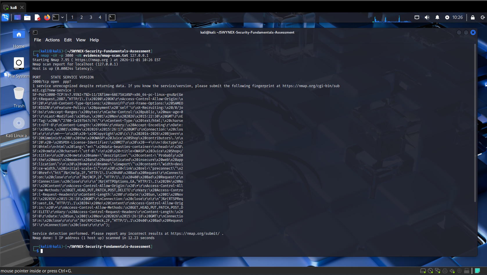</a><br><sub>Nmap service scan</sub></td><td align="center"><a href="evidence/recon-02-http-headers-and-nikto-start.png">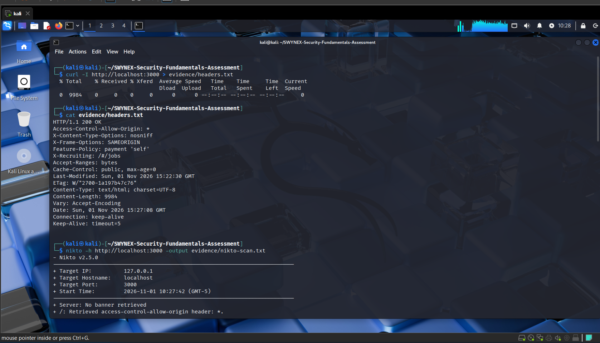</a><br><sub>HTTP headers and Nikto start</sub></td></tr>
<tr><td align="center"><a href="evidence/recon-03-nikto-results-a.png">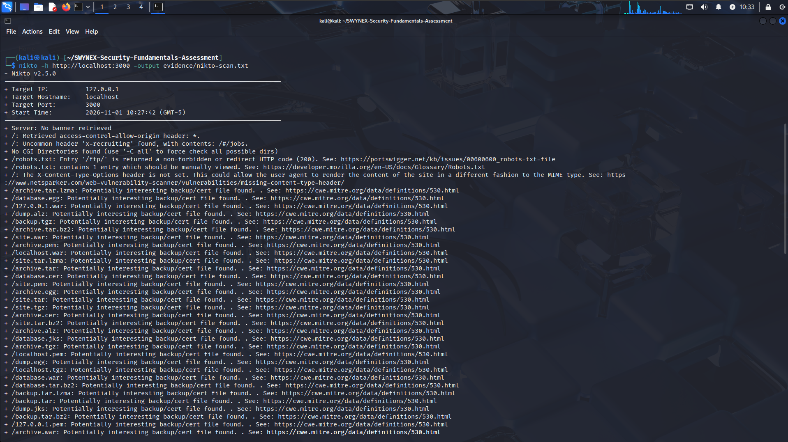</a><br><sub>Nikto results (1)</sub></td><td align="center"><a href="evidence/recon-04-nikto-results-b.png">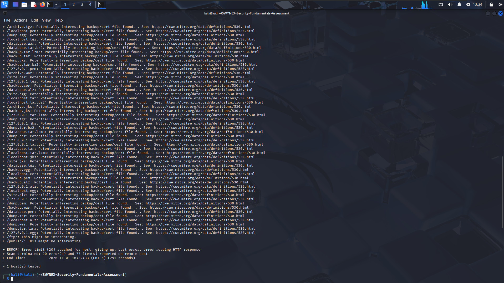</a><br><sub>Nikto results (2)</sub></td></tr>
</table>

**F1: SQL Injection (Authentication Bypass)**

<table>
<tr><td align="center"><a href="evidence/f1-sqli-01-login-payload.png">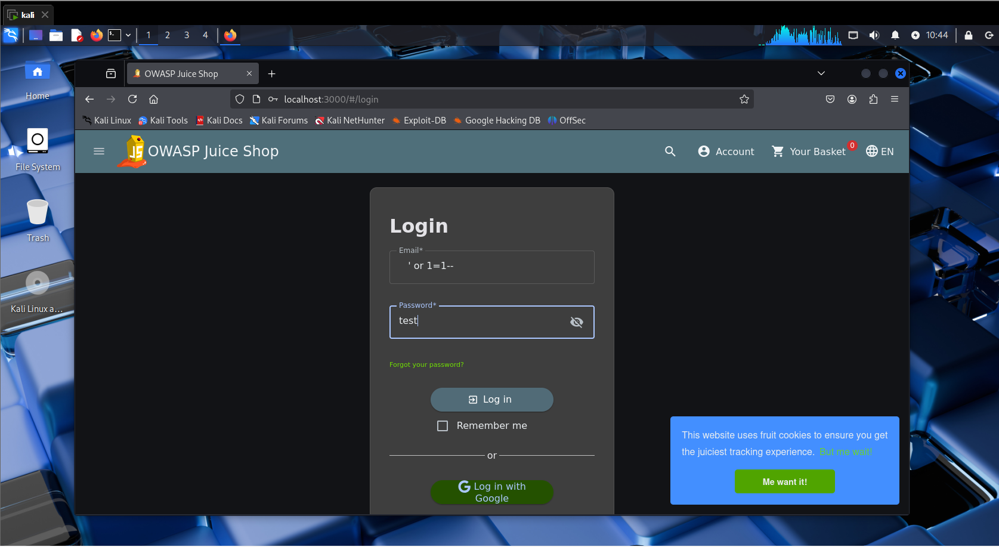</a><br><sub>Payload in login form</sub></td><td align="center"><a href="evidence/f1-sqli-02-burp-capture-redacted.png">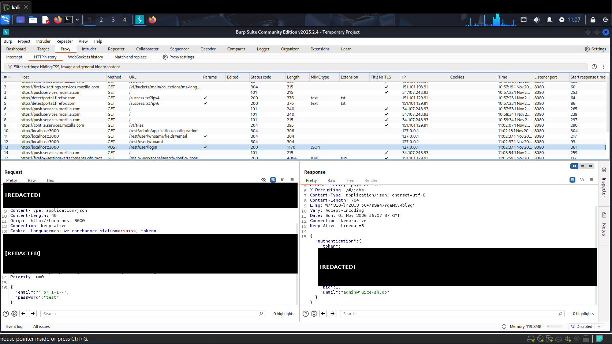</a><br><sub>Burp capture (redacted)</sub></td></tr>
<tr><td align="center"><a href="evidence/f1-sqli-03-admin-login-confirmed.png">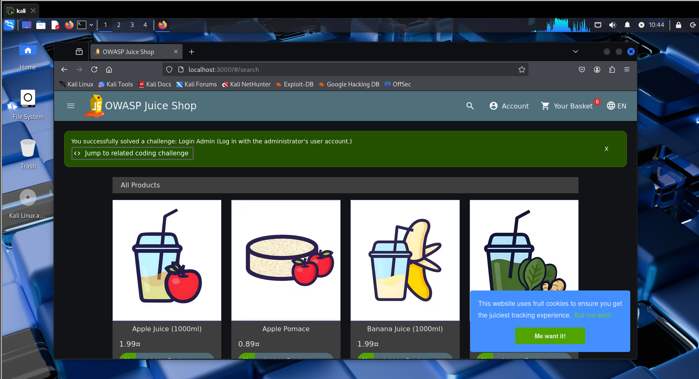</a><br><sub>Admin login confirmed</sub></td></tr>
</table>

**F2 to F4: File Exposure, Cleartext Credentials, Port Scan**

<table>
<tr><td align="center"><a href="evidence/f2-ftp-directory-exposure.png">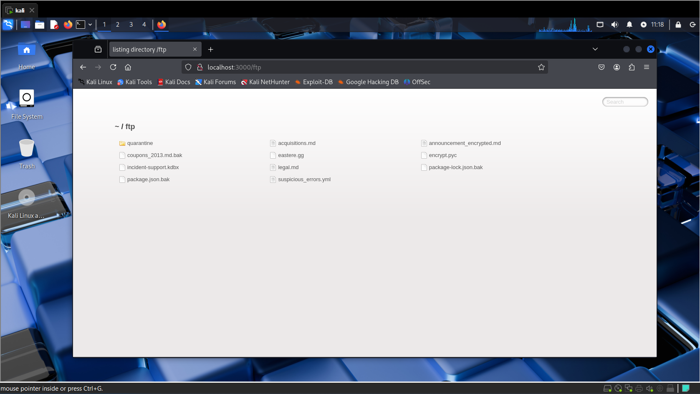</a><br><sub>F2: /ftp listing</sub></td><td align="center"><a href="evidence/f3-cleartext-credentials-redacted.png">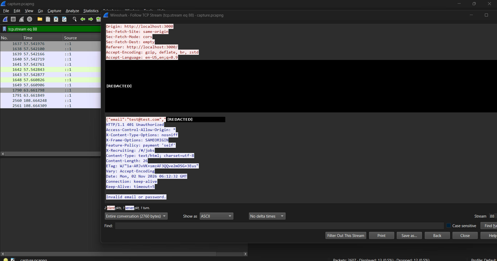</a><br><sub>F3: Cleartext (redacted)</sub></td></tr>
<tr><td align="center"><a href="evidence/f4-port-scan-pattern.png">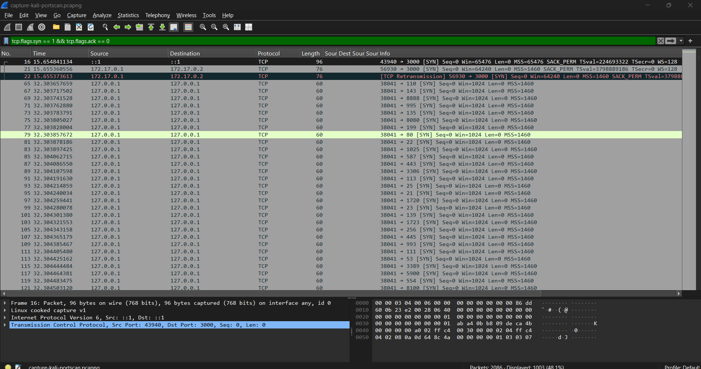</a><br><sub>F4: SYN scan pattern</sub></td></tr>
</table>

**F5, F6, F8: XSS, DNS, Protocol Hierarchy**

<table>
<tr><td align="center"><a href="evidence/f5-xss-search-alert.png">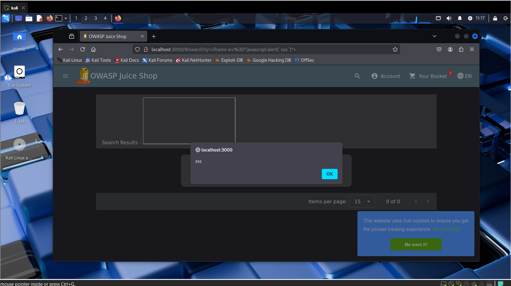</a><br><sub>F5: XSS alert</sub></td><td align="center"><a href="evidence/f6-dns-queries-redacted.png">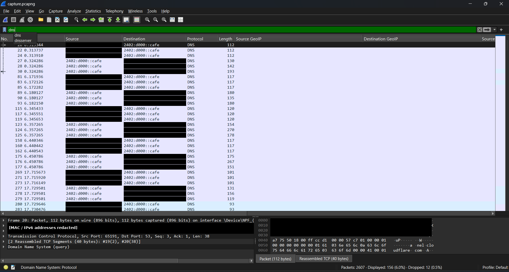</a><br><sub>F6: DNS (redacted)</sub></td></tr>
<tr><td align="center"><a href="evidence/f8-protocol-hierarchy.png">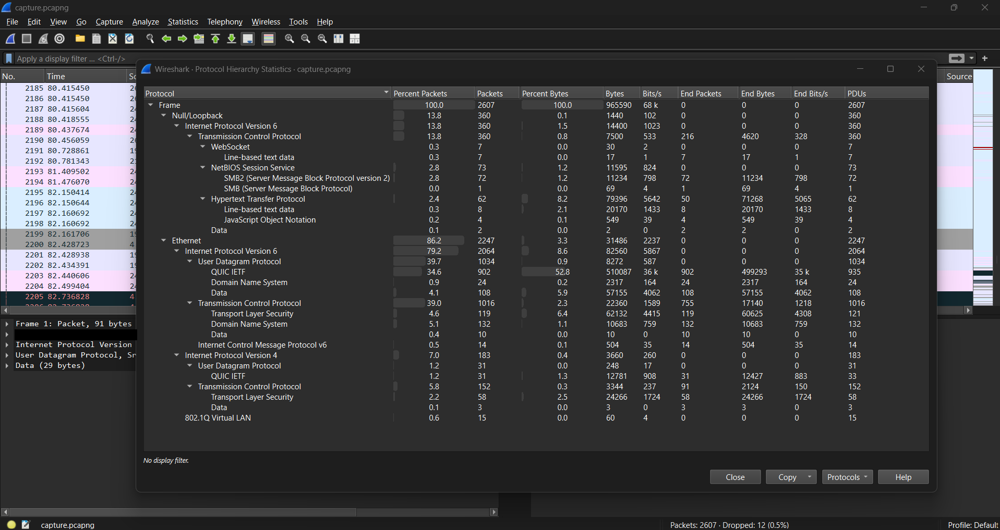</a><br><sub>F8: Protocol hierarchy</sub></td></tr>
</table>

---

## 🪜 Methodology

**Step 1 — Consolidate**
Collected the findings, evidence and notes from Tasks 1, 2 and 3 and removed duplicates.

**Step 2 — Reconnaissance review**
Re-checked the Nmap, curl and Nikto results to confirm the target, open port and header findings.

**Step 3 — Validate and triage**
Confirmed each issue was reproduced manually in Burp Suite or Wireshark. About 150 Nikto backup/cert hits were discarded as false positives because the single-page app returns HTTP 200 for almost any path.

**Step 4 — Unify risk ratings**
Rated each finding by likelihood × impact. Where earlier tasks rated the same issue differently, I chose one rating and documented why in the report.

**Step 5 — Sanitize evidence**
Redacted session tokens, passwords, cookies, MAC addresses and personal IPv6 addresses from every screenshot.

**Step 6 — Write and publish**
Wrote the executive summary, findings, remediation roadmap and limitations, then published the report and evidence.

---

## 🧠 Skills Demonstrated

| Area | What I practiced |
|---|---|
| 🌐 Web application security | SQL injection, XSS, broken access control, security misconfiguration |
| 📡 Network analysis | Wireshark filters, Follow TCP Stream, protocol hierarchy, DNS review, port scan detection |
| 🔍 Reconnaissance | Nmap, Nikto, curl, HTTP header analysis |
| 🕵️ Traffic interception | Burp Suite proxy, reading raw requests and responses |
| 📊 Risk assessment | Likelihood × impact ratings, OWASP Top 10 mapping |
| 🧹 Triage | Separating real findings from scanner false positives |
| 📝 Professional reporting | Executive summary, remediation roadmap, evidence-first documentation |
| 🔒 Data handling | Redacting credentials and personal data before publishing |

---

## 💡 What I Learned

### 1. Consistent ratings matter
The same flaw was rated differently across my earlier tasks. Choosing one method and explaining it makes a report credible.

### 2. A few common flaws can combine into a full compromise
Unsanitized input, missing access control and unencrypted traffic together allow complete takeover.

### 3. Reports are written for two audiences
The executive summary is for non-technical readers, while findings and evidence are for engineers who need to fix the issues.

### 4. Remediation should be specific and prioritized
"Use parameterized queries" is more useful than "fix input validation", and a roadmap shows what to fix first.

### 5. Protect your own evidence
Screenshots and captures can contain tokens, cookies and personal addresses, so sanitizing before publishing is part of the job.

---

## 📁 Repository Structure

```
README.md
report/
  Security-Assessment-Report.pdf     Full assessment report
evidence/                            Sanitized screenshots for each finding
```

📝 **Note:** the raw Wireshark captures also contained personal browsing traffic, so they are not published.

---

## 🔐 Security & Ethical Use

This assessment was performed for **educational and internship assessment purposes only**, against an intentionally vulnerable training application (OWASP Juice Shop) running in a private, isolated lab that I own and control. No real or third-party systems were tested. Never use these techniques against systems you do not own or have explicit permission to test.

---

## 🔗 Tools & Resources

- **OWASP Juice Shop:** https://owasp-juice.shop
- **OWASP Top 10:** https://owasp.org/www-project-top-ten/
- **Burp Suite Community:** https://portswigger.net/burp
- **Wireshark:** https://www.wireshark.org
- **Nmap:** https://nmap.org
- **Nikto:** https://cirt.net/Nikto2
- **Scapy:** https://scapy.net

---

## 👤 Author

**Mubassir**
Security Intern, SWYNEX Technologies — Task 4

---

## 📌 Project Information

**Program:** SWYNEX Technologies Internship | **Task:** 4 — Security Assessment Report | **Repository:** GitHub
